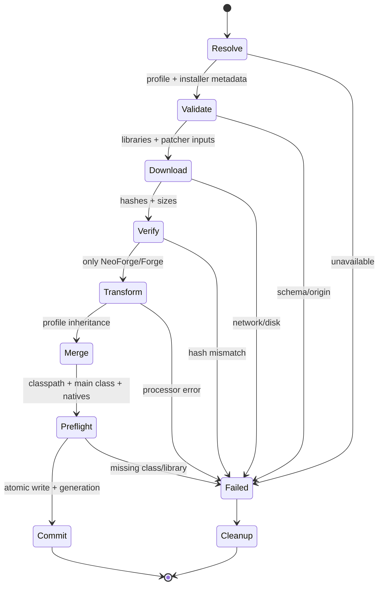
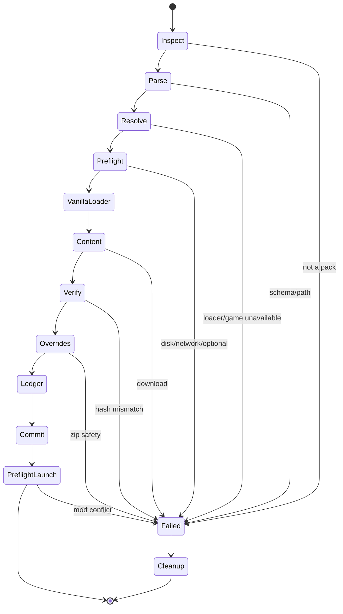

# 03 — Mod loaders, modpacks, and content

**Verified:** 2026-10-24 against loader metadata, installer profiles, Modrinth’s format specification, and the CurseForge API documentation.
**Scope:** how EclipseLauncher installs Fabric, Quilt, NeoForge and Forge; how it imports `.mrpack` and CurseForge packs; how it talks to Modrinth and CurseForge; how it keeps content trustworthy and repairable.
**Labels:** **Verified** (primary source), **Observed** (current source code or live API), **Inference** (reasoned, needs a spike), **Open** (unknown).

---

## 1. The job of this layer

A Minecraft launcher is judged on a simple sentence: *“I installed Fabric and Sodium, pressed Play, and it worked.”*

That sentence hides four different problems:

1. **Loader installation** — resolving a loader version, downloading its libraries, and producing a launchable profile that inherits from the vanilla version.
2. **Content installation** — resolving mods, resource packs, shaders, worlds and datapacks, with their dependencies, into the right directories.
3. **Modpack installation** — treating a third-party pack as a reproducible recipe, not a zip of random jars.
4. **Trust and repair** — verifying what was downloaded, explaining what is incompatible, and fixing it without reinstalling everything.

The central architectural finding of this chapter:

> **A loader profile is launch metadata, not an installer.** Fabric and Quilt can be installed by resolving a JSON profile and its Maven libraries. NeoForge and Forge additionally require a **patch/processor step** that transforms the vanilla client jar. A launcher that treats all four loaders as “download a profile and launch it” will fail on NeoForge and Forge.

The second finding:

> **The loader is only one axis of compatibility.** A mod must match the Minecraft version, the loader, the loader’s mod API generation, the side (client/server), its dependency versions, and sometimes the renderer. “Fabric 26.3” is not a compatibility guarantee; it is a filter.

---

## 2. Decisions recommended for sign-off

| Decision | Recommendation | Reason |
|---|---|---|
| v1 loader scope | **Fabric only**, plus vanilla | Fabric has the cleanest metadata API, no patched jar, Apache-2.0 licensing, and the largest current mod ecosystem. It proves the loader abstraction without forcing the installer-engine work. |
| v1 content source | **Modrinth only** | Public read API, documented `.mrpack` format, SHA-1 + SHA-512 hashes, no secret key in the client. |
| Quilt | **v1.1**, same installation engine as Fabric | Metadata and profile shape are close to Fabric; loader is beta and its per-game list can be stale. |
| NeoForge | **v1.1**, after the processor engine is proven | Requires a patched client jar and an offline processor run; the early display needs an Android-specific override. |
| Forge | **Import-only, later** | Forge’s installer explicitly asks launchers not to automate its download/install. Respect that unless written permission is obtained. |
| OptiFine | **Not supported in v1**; user-supplied jar with warnings later | Closed source, its own transformer/installer, frequent incompatibilities, no clean automation contract. |
| CurseForge | **Not in v1**; evaluate a server-side API proxy in v2 | The API key is issued to an applicant and reviewed for author consent/CDN impact; shipping it in an open APK is not acceptable. |
| Modpack install | Transactional, hash-verified, path-sandboxed, with a managed-file ledger | Packs are untrusted archives; installs must be atomic and repairable. |
| Renderer policy | **Detect renderer-sensitive mods and prefer OpenGL** | Sodium/Iris and most shader mods are OpenGL-only; Minecraft’s Vulkan backend is not a drop-in replacement for them. |

**Why not all loaders at launch?** Each loader adds a different installer, a different failure surface, and a different mod ecosystem to test. The architecture below supports all four; the *shipping* scope should earn each one.

---

## 3. Loader landscape, verified 2026-10-24

| Loader | Latest for 26.3 | License | 26.3 install mechanism | Status for Eclipse |
|---|---|---|---|---|
| **Fabric Loader** | **0.20.1** (stable) | Apache-2.0 | Metadata profile + Maven libraries; no patched jar | **Primary, v1** |
| **Fabric API** | **0.165.0+26.3** | Apache-2.0 | Ordinary mod jar in `mods/` | **Recommended companion**, not bundled |
| **Quilt Loader** | **0.31.0-beta.4** | Apache-2.0 | Metadata profile + Maven libraries; no patched jar | **Compatible, v1.1**; beta |
| **NeoForge** | **26.3.0.97** | LGPL-2.1 | `install_profile.json` processors patch the client jar; `version.json` is the launch profile | **Compatible, v1.1** |
| **Forge** | **26.3-66.1.0** | LGPL-2.1 | `install_profile.json` processors, including a binary patch; ad-supported download page | **Import-only**, unless permission is granted |
| **OptiFine** | Version for 26.3 **Open** | Closed source | Its own installer/transformer; no public automation contract | **Unsupported in v1** |
| **LiteLoader** | Legacy | Varies | Legacy installer | **Unsupported** |
| **Ornithe / Legacy Fabric** | Legacy targets | Apache-2.0 | Metadata profiles | **Out of scope**; legacy runtime tier only |

**Verified:** Fabric’s current loader list returns `0.20.1` with `stable: true`; the generated profile for 26.3 is `fabric-loader-0.20.1-26.3`. Quilt’s global loader list returns `0.31.0-beta.4`; the explicit profile endpoint returns `quilt-loader-0.31.0-beta.4-26.3`. NeoForge’s Maven metadata ends at `26.3.0.97` for the 26.3 line. Forge’s promotion file maps `26.3-latest` and `26.3-recommended` to `66.1.0`.

**Observed:** Fabric API `0.165.0+26.3` is the newest Fabric API release for 26.3 on Modrinth (published 2026-10-23). Sodium’s newest 26.3 Fabric build is `0.9.3-beta.1` (2026-10-15); Iris’s newest 26.3 Fabric build is `1.11.7+26.3-fabric` (2026-09-30).

**Important:** these are point-in-time versions. The launcher must discover them, not hard-code them, except for a small **certified catalog** used to label “tested with Eclipse.”

---

## 4. The common model

### 4.1 Four objects

```text
Instance
  ├── game version        (26.3, 26.4-snapshot-5, …)
  ├── loader              (none | fabric | quilt | neoforge | forge)
  ├── loader version      (0.20.1, …)
  ├── content set         (mods, packs, configs, worlds)
  └── launch overrides    (heap, renderer, resolution, JVM flags)

VersionProfile
  ├── vanilla JSON        (immutable, hash-verified)
  ├── loader profile      (inheritsFrom vanilla; adds mainClass, args, libraries)
  └── install recipe      (only NeoForge/Forge: processors + patched jar)

ContentFile
  ├── logical role        (mod | resourcepack | shader | world | datapack | config)
  ├── destination path    (sandboxed, relative to instance)
  ├── source              (Modrinth CDN | CurseForge | Mojang | user file)
  ├── hashes + size
  └── provenance          (project, version, pack, author, license)

ManagedFileLedger
  ├── files installed by the launcher
  ├── hashes at install time
  ├── pack/version that owns each file
  └── user-modified flags
```

The ledger is the difference between “install” and “update.” Without it, a launcher cannot tell a pack’s `config/foo.toml` from a user’s edited `config/foo.toml`, and will either overwrite work or leave stale files.

### 4.2 Merge and launch rules

The vanilla/loader merge rules are in [doc 02](02-minecraft-platform.md), §3.1. For this chapter, the loader-specific invariants are:

1. **Parent first, child last.** A loader profile inherits the vanilla version; its `mainClass` and arguments override or append.
2. **Libraries are concatenated and de-duplicated by Maven coordinate.** Do not sort alphabetically; order is part of the launch contract.
3. **The loader’s main class must be present on the final classpath.** Validate before launch, not after the JVM starts.
4. **Loader JVM arguments are untrusted input.** Filter desktop-only flags exactly as with vanilla’s `default-user-jvm`.
5. **The final profile must retain provenance.** “This library came from Fabric 0.20.1” is required for diagnosis.
6. **The Android native set replaces, not supplements, the desktop native set.** Loader libraries may include LWJGL modules; their desktop natives must never reach `java.library.path`.

### 4.3 What “installed” means

A loader is installed only when all of the following are true:

- every declared library exists and matches its hash;
- the final merged profile parses and validates;
- the loader main class is loadable from the classpath;
- the profile ID and `inheritsFrom` match the instance;
- the instance has a lock file and a committed generation number;
- a **preflight** can build the classpath and read every jar without launching Minecraft.

A directory with a `fabric-loader-…json` file is not “installed.”

---

## 5. Fabric

### 5.1 Metadata contract

Fabric Meta exposes version lists and ready-made launcher profiles:

```text
GET https://meta.fabricmc.net/v2/versions/loader
GET https://meta.fabricmc.net/v2/versions/loader/{game_version}
GET https://meta.fabricmc.net/v2/versions/loader/{game_version}/{loader_version}/profile/json
```

**Verified** for 26.3 + 0.20.1, the profile is:

```json
{
  "id": "fabric-loader-0.20.1-26.3",
  "inheritsFrom": "26.3",
  "type": "release",
  "mainClass": "net.fabricmc.loader.impl.launch.knot.KnotClient",
  "arguments": {
    "game": [],
    "jvm": ["-DFabricMcEmu= net.minecraft.client.main.Main "]
  },
  "libraries": [
    { "name": "org.ow2.asm:asm:9.10.1", "url": "https://maven.fabricmc.net/", "sha1": "ada2141c…", "size": 126151 },
    { "name": "org.ow2.asm:asm-analysis:9.10.1", "url": "https://maven.fabricmc.net/", "sha1": "8d49f14d…", "size": 35140 },
    { "name": "org.ow2.asm:asm-commons:9.10.1", "url": "https://maven.fabricmc.net/", "sha1": "4229e4c5…", "size": 74840 },
    { "name": "org.ow2.asm:asm-tree:9.10.1", "url": "https://maven.fabricmc.net/", "sha1": "e244332a…", "size": 51958 },
    { "name": "org.ow2.asm:asm-util:9.10.1", "url": "https://maven.fabricmc.net/", "sha1": "7bb9d450…", "size": 95628 },
    { "name": "net.fabricmc:sponge-mixin:0.17.5+mixin.0.8.7", "url": "https://maven.fabricmc.net/", "sha1": "0cef8519…", "size": 1551593 },
    { "name": "net.fabricmc:fabric-loader:0.20.1", "url": "https://maven.fabricmc.net/" }
  ]
}
```

The profile has **seven** libraries. Six carry hashes and sizes; the loader jar itself does not. That is a deliberate gap the launcher must close.

### 5.2 Install algorithm

```text
installFabric(instance, gameVersion, loaderVersion):
  1. GET /v2/versions/loader/{gameVersion}
     - reject if the loader version is absent
     - prefer stable=true unless the user chose advanced/beta
  2. GET /v2/versions/loader/{gameVersion}/{loaderVersion}/profile/json
  3. Verify profile.inheritsFrom == gameVersion
     Verify profile.mainClass is non-empty
  4. Resolve every library:
       a. if download URL + hash + size are present: use them
       b. else resolve from Maven base URL + coordinate
       c. fetch .sha1 / .sha256 sidecar when available
       d. if no hash exists: pin the first-seen SHA-256 in the instance
          and mark the artifact "trust-on-first-use" in diagnostics
  5. Download to cache/<sha256>.part, verify, rename to cache/<sha256>
  6. Build the merged profile: parent 26.3 + child Fabric
  7. Write profile atomically to versions/fabric-loader-{loader}-{game}/
  8. Commit generation; release lock
  9. Preflight: classpath readable, main class present, no duplicate
     conflicting ASM/Mixin versions, native set matches ABI
```

**Why the loader jar lacks a hash:** Fabric Meta’s `launcherMeta.libraries.common` contains hashes for the six support libraries but not for `fabric-loader` itself; the loader version list separately publishes the loader artifact’s Maven coordinate, and Maven repositories publish `.sha1` sidecars. EclipseLauncher should fetch the sidecar and record the SHA-256 locally. For the **certified** Fabric version, the expected SHA-1 can also be pinned in the app’s signed loader catalog.

### 5.3 Fabric quirks that matter

**`-DFabricMcEmu= net.minecraft.client.main.Main ` must be preserved verbatim.** The value contains a leading and trailing space. The launcher must not “clean” it, trim it, or re-quote it into a different token. It tells Fabric Loader which vanilla main class to emulate. If the argument is mangled, Fabric may fail to find the game entry point or may launch the wrong class.

**Do not add `-javaagent` for Fabric.** Modern Fabric Loader uses its own classloader and Mixin; adding a javaagent is not part of the profile and can conflict with Android’s class loading.

**Fabric API is a mod, not a loader dependency.** Installing Fabric Loader does not install Fabric API. Many mods require it; the content resolver must treat it as a normal Modrinth project and respect the pack’s pinned version. Do not silently install the latest Fabric API into a pack that pins an older one.

**ASM/Mixin versions are part of the contract.** Fabric 0.20.1 pins ASM 9.10.1 and Mixin 0.17.5. If another mod ships a shaded ASM, do not remove it from the mod jar; only manage the loader’s classpath. Duplicate unshaded ASM on the classpath is a real conflict.

**Fabric has no patched client jar and no early display.** That is why it is the right first loader: the installer is a resolver, not a binary transformer.

### 5.4 Fabric failure modes

| Code | Cause | Action |
|---|---|---|
| `LOADER_VERSION_UNAVAILABLE` | Loader/game pair absent from Meta | Offer the nearest stable loader or a different game version |
| `LOADER_PROFILE_INVALID` | Missing main class / wrong `inheritsFrom` | Re-fetch profile; report schema |
| `LOADER_LIB_HASH_MISSING` | Maven sidecar absent | Use pinned catalog hash; otherwise mark untrusted and ask |
| `LOADER_MAIN_CLASS_MISSING` | Loader jar not on classpath | Repair loader; show classpath provenance |
| `LOADER_MIXIN_CONFLICT` | Duplicate/incompatible Mixin | Show the two jars and their versions; do not auto-delete |
| `LOADER_FABRIC_EMU_MANGLED` | Argument was trimmed/re-tokenized | Rebuild args from the profile verbatim |

---

## 6. Quilt

### 6.1 Metadata contract

```text
GET https://meta.quiltmc.org/v3/versions/loader
GET https://meta.quiltmc.org/v3/versions/loader/{game_version}
GET https://meta.quiltmc.org/v3/versions/loader/{game_version}/{loader_version}/profile/json
```

**Verified** for 26.3 + 0.31.0-beta.4, the profile is:

```json
{
  "id": "quilt-loader-0.31.0-beta.4-26.3",
  "inheritsFrom": "26.3",
  "type": "release",
  "mainClass": "org.quiltmc.loader.impl.launch.knot.KnotClient",
  "arguments": { "game": [] },
  "libraries": [
    { "name": "net.fabricmc:sponge-mixin:0.17.4+mixin.0.8.7", "url": "https://maven.fabricmc.net/" },
    { "name": "org.quiltmc:quilt-json5:1.0.4+final", "url": "https://maven.quiltmc.org/repository/release/" },
    { "name": "org.ow2.asm:asm:9.10.1", "url": "https://maven.fabricmc.net/" },
    { "name": "org.ow2.asm:asm-analysis:9.10.1", "url": "https://maven.fabricmc.net/" },
    { "name": "org.ow2.asm:asm-commons:9.10.1", "url": "https://maven.fabricmc.net/" },
    { "name": "org.ow2.asm:asm-tree:9.10.1", "url": "https://maven.fabricmc.net/" },
    { "name": "org.ow2.asm:asm-util:9.10.1", "url": "https://maven.fabricmc.net/" },
    { "name": "org.quiltmc:quilt-config:1.3.3", "url": "https://maven.quiltmc.org/repository/release/" },
    { "name": "org.quiltmc:quilt-loader:0.31.0-beta.4", "url": "https://maven.quiltmc.org/repository/release/" }
  ]
}
```

The profile has **nine** libraries, and none of them carry a hash or size. This is a materially weaker metadata contract than Fabric’s.

### 6.2 A real metadata trap

**Observed:** `GET https://meta.quiltmc.org/v3/versions/loader/26.3` returned a list whose first entry is **0.20.0-beta.9**, not 0.31.0-beta.4. The explicit endpoint for 0.31.0-beta.4 returns a valid 26.3 profile, and the global loader list contains 0.31.0-beta.4.

This means:

- Do **not** assume “first entry in the per-game list = newest compatible loader.”
- Do **not** infer compatibility from the order of the per-game list.
- Use the global loader list for versions, then request the explicit profile and validate `id` + `inheritsFrom`.
- Treat a per-game list that lags the global list as a metadata-quality signal, not as a hard incompatibility.

**Recommended policy:** Quilt is “Compatible” rather than “Certified” until the profile for the chosen version passes the same preflight and a real 26.3 launch test.

### 6.3 Install algorithm

The algorithm is identical to Fabric’s, with three differences:

1. Resolve the loader version from the **global** list, not the per-game list.
2. Every library needs Maven sidecar resolution and a locally pinned SHA-256 (or a certified catalog hash).
3. Validate Mixin version. Quilt 0.31.0-beta.4 pins Mixin **0.17.4**, while Fabric 0.20.1 pins **0.17.5**. Do not mix profiles from the two loaders in one instance.

### 6.4 Quilt compatibility and licensing

- **License:** Quilt Loader is Apache-2.0 (**verified** from the repository license and GitHub metadata). This is compatible with an Apache-2.0 launcher.
- **Fabric mods:** Quilt advertises compatibility with many Fabric mods, but this is not universal. Treat each mod as unverified unless the pack author or the mod declares Quilt support. Do not promise “Fabric mods just work.”
- **Beta status:** 0.31.0-beta.4 is a beta. It should be offered behind “Advanced / experimental,” with a clear warning, not as the default for new users.
- **Ecosystem:** smaller than Fabric and NeoForge. The product should not lead with Quilt.

### 6.5 Recommendation

Ship Quilt in **v1.1**, after Fabric. Reuse the Fabric resolver, but keep a separate loader adapter and a separate test fixture. Do not let “same shape” become “same code path without validation.”

---

## 7. NeoForge

### 7.1 Two documents, one install

NeoForge publishes an **installer** containing:

- `install_profile.json` — the installation recipe: data placeholders, processors, and installer libraries;
- `version.json` — the final launch profile: `inheritsFrom`, main class, arguments, and runtime libraries.

**Verified** for NeoForge 26.3.0.97:

```json
// install_profile.json (abridged)
{
  "spec": 1,
  "profile": "NeoForge",
  "version": "neoforge-26.3.0.97",
  "minecraft": "26.3",
  "json": "/version.json",
  "data": {
    "BINPATCH": { "client": "/data/client.lzma", "server": "/data/client.lzma" },
    "PATCHED": {
      "client": "[net.neoforged:minecraft-client-patched:26.3.0.97]",
      "server": "[net.neoforged:minecraft-server-patched:26.3.0.97]"
    },
    "MCP_VERSION": { "client": "'26.3-1'", "server": "'26.3-1'" }
  },
  "processors": [
    {
      "sides": ["server"],
      "jar": "net.neoforged.installertools:installertools:4.0.17:fatjar",
      "args": ["--task", "EXTRACT_FILES", "..."]
    },
    {
      "jar": "net.neoforged.installertools:installertools:4.0.17:fatjar",
      "args": [
        "--task", "PROCESS_MINECRAFT_JAR",
        "--no-mod-manifest",
        "--input", "{MINECRAFT_JAR}",
        "--output", "{PATCHED}",
        "--extract-libraries-to", "{ROOT}/libraries/",
        "--apply-patches", "{BINPATCH}"
      ]
    }
  ]
}
```

```json
// version.json (abridged)
{
  "id": "neoforge-26.3.0.97",
  "inheritsFrom": "26.3",
  "mainClass": "net.neoforged.fml.startup.Client",
  "arguments": {
    "game": [
      "--fml.neoForgeVersion", "26.3.0.97",
      "--fml.mcVersion", "26.3",
      "--fml.neoFormVersion", "1"
    ],
    "jvm": [
      "-Djava.net.preferIPv6Addresses=system",
      "-DlibraryDirectory=${library_directory}",
      "--add-opens", "java.base/java.lang.invoke=ALL-UNNAMED",
      "--add-exports", "jdk.naming.dns/com.sun.jndi.dns=java.naming"
    ]
  }
}
```

**Counts:** the NeoForge 26.3.0.97 installer declares **30 installer libraries** and a **27-library** launch profile. The Forge 26.3-66.1.0 installer declares **16 installer libraries** and a **40-library** launch profile. These are different sets; do not use one as a substitute for the other.

### 7.2 What the client processor actually does

For a client installation, only the **no-sides** processor runs:

```text
PROCESS_MINECRAFT_JAR
  --no-mod-manifest
  --input       {MINECRAFT_JAR}          (26.3 client.jar)
  --output      {PATCHED}                (net.neoforged:minecraft-client-patched:26.3.0.97)
  --extract-libraries-to {ROOT}/libraries/
  --apply-patches {BINPATCH}             (data/client.lzma)
```

It produces a **patched client jar** and extracts libraries. The resulting jar is a derivative of Minecraft and **must never be redistributed**; it stays in the instance’s private storage.

The server-side `EXTRACT_FILES` processor writes `run.sh`, `run.bat`, `user_jvm_args.txt` and argument files. EclipseLauncher does not need those on Android. Skip server-only processors, and do not create desktop launch scripts.

### 7.3 Client install algorithm

```text
installNeoForge(instance, gameVersion, neoVersion):
  1. Resolve installer URL from NeoForged Maven:
       net/neoforged/neoforge/{version}/neoforge-{version}-installer.jar
  2. Download installer to cache; verify SHA-1/SHA-256 from Maven sidecars.
  3. Open the installer as a zip. Read install_profile.json and version.json.
  4. Validate:
       - spec == 1
       - minecraft == gameVersion
       - profile/version/id are consistent
       - version.json.inheritsFrom == gameVersion
  5. Download every installer library and every version.json library
     to the shared Maven cache; verify hashes.
  6. Materialize placeholders:
       {ROOT}            -> instance/loader/neoforge-{version}/
       {INSTALLER}       -> cached installer jar
       {MINECRAFT_JAR}   -> cached 26.3 client.jar
       {LIBRARY_DIR}     -> shared libraries root
       {BINPATCH}        -> extracted data/client.lzma
       {PATCHED}         -> [net.neoforged:minecraft-client-patched:{version}]
  7. Run the no-sides processor in an isolated :installer process:
       classpath = installertools fatjar + processor classpath
       main      = processor main class from the jar manifest
       args      = expanded processor args
       env       = no tokens, no network, private tmp, memory cap
  8. Verify the patched jar exists, is a valid zip, contains the expected
     classes, and its size is plausible. (No published output hash.)
  9. Merge version.json over 26.3; write the launch profile atomically.
 10. Preflight: main class present, ${library_directory} expanded,
     earlyWindowControl=false written to config/fml.toml.
```

### 7.4 The Android-specific early-display problem

NeoForge’s “fancy early loading display” creates its own window before Minecraft’s main window. On a desktop this is harmless. On Android, it is a second native window/GL context racing the SDL3/EGL surface that EclipseLauncher owns. It is a likely startup crash or black screen.

**Verified (NeoForged):** the supported workaround is to edit `config/fml.toml`:

```toml
earlyWindowControl=false
```

**EclipseLauncher policy:** when creating a NeoForge instance, write `earlyWindowControl=false` into the instance’s `config/fml.toml` **before the first launch**, and explain it in diagnostics as “Android uses the launcher’s window; NeoForge’s separate early window is disabled.” Do not wait for the user to hit the error. Keep the setting visible in Advanced so it can be re-enabled for testing.

This is also a test case for the broader principle: **desktop-first loader behavior must be adapted at the instance level, not patched globally.**

### 7.5 Launch argument hazards

- **`${library_directory}` must be expanded.** NeoForge uses it to locate its libraries. If it reaches the JVM literally, NeoForge will fail to find its own modules.
- **`--add-opens java.base/java.lang.invoke=ALL-UNNAMED`** is required by modern FML. Keep it.
- **`--add-exports jdk.naming.dns/com.sun.jndi.dns=java.naming`** is required for DNS handling. Keep it.
- **Do not add Fabric’s `-DFabricMcEmu`.** It is meaningless for NeoForge and may confuse class loading.
- **Do not add Forge’s `--launchTarget forge_client`.** NeoForge uses `--fml.*` arguments, not Forge’s bootstrap target.
- **Filter the inherited vanilla JVM flags** (`-Xms2G`, `-Xmx4G`, `AlwaysPreTouch`, ZGC) before appending NeoForge’s.

### 7.6 Failure modes

| Code | Cause | Action |
|---|---|---|
| `NEO_INSTALLER_INVALID` | Missing/invalid `install_profile.json` or `version.json` | Re-download installer; verify hash |
| `NEO_PROCESSOR_FAILED` | Installertools error, missing library, bad patch | Show processor stdout/stderr tail; re-download inputs |
| `NEO_PATCHED_JAR_INVALID` | Output is not a valid jar / missing classes | Retry in clean temp dir; report |
| `NEO_EARLY_WINDOW_FAILED` | Early display could not create a window | Write `earlyWindowControl=false`; retry |
| `NEO_LIBRARY_DIR_UNEXPANDED` | `${library_directory}` reached the JVM | Rebuild args; fail closed |
| `NEO_MAIN_CLASS_MISSING` | Patched jar or loader libraries absent | Repair loader |

### 7.7 Licensing and process isolation

NeoForge is **LGPL-2.1**. EclipseLauncher does not link against NeoForge at build time; it downloads and runs it at the user’s direction. Keep the license text and notices, and do not ship NeoForge inside the APK.

The processor step executes third-party build tooling. Even though it is first-party NeoForged code, treat it as untrusted:

- run it in a dedicated `:installer` process, not the UI process;
- give it no account tokens and no network access (all inputs pre-downloaded);
- cap its heap and wall-clock time;
- write only inside the instance’s staging directory;
- verify outputs before publishing them to the instance.

---

## 8. Forge

### 8.1 The automation request

The Forge 26.3-66.1.0 installer’s `install_profile.json` begins with an explicit request:

```json
"_comment": [
  "Please do not automate the download and installation of Forge.",
  "Our efforts are supported by ads from the download page.",
  "If you MUST automate this, please consider supporting the project through https://www.patreon.com/LexManos/"
]
```

**Verified** in the installer jar. This is not a license term; it is a direct request from the project. It matters because:

- Forge’s download page is ad-supported;
- launchers that scrape the page or hotlink the ad-funded installer undermine that support;
- the Forge team has historically been sensitive about launcher automation.

**EclipseLauncher policy:** do not automate Forge download/install in v1. Do not scrape the Forge site. Do not bundle the installer. Offer a documented manual path.

### 8.2 What a manual Forge install requires

Forge 26.3-66.1.0 uses the same installer-spec shape as NeoForge, but with a **binary patch** step and a bootstrap main class:

```json
// version.json (abridged)
{
  "id": "26.3-forge-66.1.0",
  "inheritsFrom": "26.3",
  "mainClass": "net.minecraftforge.bootstrap.ForgeBootstrap",
  "arguments": {
    "game": ["--launchTarget", "forge_client"],
    "jvm": [
      "-Djava.net.preferIPv6Addresses=system",
      "-XX:+UseCompactObjectHeaders",
      "-XX:StackShadowPages=32"
    ]
  }
}
```

The client-side processor applies `data/client.lzma` to the vanilla client jar with `net.minecraftforge:binarypatcher:1.3.4`, producing a patched client artifact. The launch profile then uses `ForgeBootstrap` and the `forge_client` launch target.

### 8.3 Options, ranked

| Option | What it means | Verdict |
|---|---|---|
| **A. Manual import** | User downloads the Forge installer/profile on the web; Eclipse imports the resulting version JSON and libraries or runs a user-supplied installer in a sandbox | **Recommended for v1** |
| **B. Permission** | Ask the Forge team for written permission to automate, with a support/patronage plan | Best long-term; unknown timeline |
| **C. No support** | Detect Forge instances and explain they are unsupported | Acceptable but loses a large pack audience |
| **D. Automate anyway** | Scrape/hotlink the installer and run it silently | **Rejected**; violates the project’s stated request and community trust |

### 8.4 Manual import flow

1. User taps **Add instance → Import → Forge**.
2. App explains: “Forge asks launchers not to automate installation. Download the installer from the official page, then return here.”
3. App opens `https://files.minecraftforge.net/` in the browser (not a scraped direct link).
4. User selects the installer `.jar` with the system file picker.
5. App verifies it is a valid Forge installer and that its `minecraft` field matches the chosen version.
6. App extracts `version.json`, libraries and `data/client.lzma` into a staging area.
7. App runs the binary patcher **only after an explicit confirmation** that the user supplied the installer.
8. App writes the profile, sets `earlyWindowControl=false` (Forge also has an early window), and validates.

This is more friction than Fabric, but it is honest, legal, and respectful. It also avoids shipping an ad-funded binary.

### 8.5 Forge early window

Forge’s early loading screen has the same Android problem as NeoForge’s. The legacy switch is `-Dfml.earlyprogresswindow=false`; modern Forge also exposes `earlyWindowControl` in `config/fml.toml`. EclipseLauncher should set the config value for imported Forge instances and document the override.

### 8.6 Forge license

Forge is LGPL-2.1 (**verified** from its license file). As with NeoForge, download at runtime; keep notices; do not bundle.

---

## 9. OptiFine and other transformers

| Component | Status | Why |
|---|---|---|
| **OptiFine** | **Unsupported in v1** | Closed source; its own installer and transformer; no public automation contract; frequent conflicts with Fabric/NeoForge; redistribution prohibited. |
| **OptiFabric** | **Unsupported** | A compatibility layer for a closed-source transformer; version lag; hard to support. |
| **LiteLoader** | **Unsupported** | Legacy; no 26.x path. |
| **Ornithe / Legacy Fabric** | **Out of scope** | Only relevant to the legacy runtime tier. |
| **VulkanMod** | **Advanced, not default** | A third-party renderer replacement; conflicts with Sodium/Iris and with Minecraft’s own Vulkan backend. |
| **Sinytra Connector** | **Advanced, not default** | Runs Fabric mods on NeoForge; useful but a compatibility layer with its own failure modes. |

**OptiFine policy if added later:** user-supplied jar only; no download automation; explicit warning that it is closed source and may conflict; a dedicated “OptiFine instance” type so it does not contaminate normal Fabric instances.

---

## 10. Modpack formats

### 10.1 Modrinth `.mrpack`

**Verified** against Modrinth’s format specification:

```text
my_pack.mrpack                (ZIP, UTF-8)
├── modrinth.index.json
├── overrides/                (copied to instance root)
├── client-overrides/         (optional, applied after overrides)
└── server-overrides/         (optional, server only)
```

`modrinth.index.json`:

```json
{
  "formatVersion": 1,
  "game": "minecraft",
  "versionId": "1.0.0",
  "name": "Example Pack",
  "summary": "A short description",
  "files": [
    {
      "path": "mods/sodium-fabric-0.9.3.jar",
      "hashes": {
        "sha1": "cc297357…",
        "sha512": "d0760a2d…"
      },
      "env": { "client": "required", "server": "unsupported" },
      "downloads": [
        "https://cdn.modrinth.com/data/AANobbMI/versions/…/sodium.jar"
      ],
      "fileSize": 1912496
    }
  ],
  "dependencies": {
    "minecraft": "26.3",
    "fabric-loader": "0.20.1"
  }
}
```

Rules the launcher must enforce:

1. **`formatVersion` must be 1.** Unknown versions fail with an update message, not a best-effort parse.
2. **`game` must be `minecraft`.**
3. **Each file needs SHA-1 and SHA-512.** Modrinth’s spec says both are mandatory. Verify both; prefer SHA-512 for the security decision.
4. **`path` is relative to the instance root.** Reject absolute paths, `..`, drive letters, backslashes, NUL, and paths that escape after normalization.
5. **`downloads` is an array of HTTPS URLs.** Modrinth’s upload validation allows `cdn.modrinth.com`, `github.com`, `raw.githubusercontent.com`, and `gitlab.com`. Eclipse should enforce a host allowlist and follow at most three redirects, re-checking the final host.
6. **`env.client` controls installation.** `unsupported` means skip on client; `optional` means ask the user; `required` means install.
7. **`dependencies` identifies the loader.** Support `minecraft`, `fabric-loader`, `quilt-loader`, `neoforge`, `forge`. Reject multiple loaders in one pack. Unknown dependency IDs are a warning, not a silent ignore.
8. **`overrides` then `client-overrides`.** Apply in that order; `server-overrides` is ignored on client. The pack’s `overrides` may contain configs, scripts, resource packs, and worlds.

**Do not** trust `fileSize` as a security control; use it for progress and a sanity bound. Verify hashes.

### 10.2 CurseForge pack `.zip`

**Observed** in FCL’s `CurseManifest` and the public format documentation:

```text
my_pack.zip
├── manifest.json
├── modlist.html             (optional, human-readable)
└── overrides/
    ├── config/
    ├── scripts/
    └── ...
```

```json
{
  "manifestType": "minecraftModpack",
  "manifestVersion": 1,
  "name": "Example Pack",
  "version": "1.0.0",
  "author": "someone",
  "minecraft": {
    "version": "26.3",
    "modLoaders": [
      { "id": "neoforge-26.3.0.97", "primary": true }
    ]
  },
  "files": [
    { "projectID": 238222, "fileID": 5246076, "required": true }
  ],
  "overrides": "overrides"
}
```

Key differences from `.mrpack`:

- Files are referenced by **CurseForge project ID + file ID**, not by URL or hash.
- The manifest itself has **no hashes**; the launcher must fetch the file record from the API and verify its SHA-1 and size.
- `modLoaders[].id` is a string such as `forge-47.2.0`, `fabric-0.16.5`, `neoforge-26.3.0.97`, or `quilt-0.31.0-beta.4`. Parse the prefix; choose the `primary: true` entry; reject multiple primaries.
- `overrides` names the folder to copy; do not assume it is literally `overrides` without validating it is a safe relative path.
- `required: false` means the file is optional; the launcher should offer it, not silently install it.

**Critical:** a CurseForge pack cannot be installed without the CurseForge API (or a mirror). The manifest has no download URLs and no hashes. This is why CurseForge support is coupled to the API-key decision in §11.3.

### 10.3 Format detection

Detect by content, not extension:

1. Open the zip; reject encrypted entries.
2. If `modrinth.index.json` exists → Modrinth.
3. Else if `manifest.json` exists and `manifestType == "minecraftModpack"` → CurseForge.
4. Else if `pack.mcmeta` exists at root → resource pack.
5. Else if `level.dat` exists → world.
6. Else → unknown archive; explain supported formats.

Never execute a file just because it is named `installer.jar`.

### 10.4 Install transaction

```text
importPack(archive):
  1. Inspect archive in memory/stream; do not extract to the final directory.
  2. Parse manifest; validate schema, paths, counts, sizes.
  3. Resolve game + loader; ensure the runtime can satisfy it.
  4. Build a ContentPlan: every file, source, hash, destination, env.
  5. Preflight: free space, network, optional files, conflicts.
  6. Install vanilla + loader into the shared store (if absent).
  7. Download content into staging/<txn>/ with hash verification.
  8. Extract overrides into staging, with zip-slip/zip-bomb guards.
  9. Write the managed-file ledger and instance metadata.
 10. Atomically rename staging/<txn> to instances/<id>/; bump generation.
 11. Run preflight (classpath, loader, duplicate mod IDs, renderer policy).
 12. Mark ready; optionally open the instance.
```

If any step fails, delete staging and leave the previous instance untouched. A failed import must never produce a half-installed instance that looks launchable.

### 10.5 Optional files

- `.mrpack`: `env.client == "optional"` → show a checklist with name, size, description, and dependency implications. Default: unchecked unless the pack author marks it required.
- CurseForge: `required: false` → same treatment.
- Never silently install optional performance mods or shader packs; they change behavior and can break rendering.

### 10.6 Update semantics

A pack update is not “delete the instance and reinstall.” Use the ledger:

```text
updatePack(instance, newArchive):
  1. Parse new manifest; build new ContentPlan.
  2. For each old managed file:
       - if unchanged since install and absent from new plan -> delete
       - if changed by user -> keep, mark "user-modified", warn
       - if present in new plan with same hash -> keep
       - if present with new hash -> replace atomically
  3. Apply new overrides only to files the ledger says are managed
     or that do not exist.
  4. Back up saves/ and config/ (one rolling backup) before applying.
  5. Commit new ledger + generation.
```

**Three-way merge rule:** base = old pack file, local = current file, incoming = new pack file. If local == base, take incoming. If local != base and incoming != base, keep local and show a conflict list. This is the only way to avoid destroying user configs.

### 10.7 What not to do

**Observed:** FCL’s `ModrinthCompletionTask` downloads `.mrpack` files without passing the manifest hashes to its download task; it checks path safety and skips existing files, but does not verify SHA-1/SHA-512 for those downloads. That is a concrete example of a mature launcher leaving a supply-chain gap. EclipseLauncher should verify both hashes and record them in the ledger.

Other anti-patterns:

- extracting a pack directly into the live instance;
- trusting `fileSize` instead of hashing;
- following arbitrary download hosts;
- overwriting all configs on update;
- deleting the whole instance on failure;
- auto-installing optional mods;
- executing pack scripts during install;
- using a CurseForge API key embedded in the APK.

---

## 11. Content APIs

### 11.1 Modrinth

**Base:** `https://api.modrinth.com/v2` (v2 is current; v3 is not GA).
**Auth:** none for reads. A unique `User-Agent` is **required**.
**Rate limit:** 300 requests/minute per IP (**verified** in the API docs). Read `X-Ratelimit-Limit`, `X-Ratelimit-Remaining`, `X-Ratelimit-Reset`; back off on 429.

Endpoints used:

| Purpose | Endpoint |
|---|---|
| Search | `GET /search?query=…&facets=…&index=…&offset=…&limit=…` |
| Project | `GET /project/{id|slug}` |
| Project versions | `GET /project/{id|slug}/version?loaders=[…]&game_versions=[…]` |
| Version | `GET /version/{id}` |
| File by hash | `GET /version_file/{hash}?algorithm=sha1` |
| Bulk file lookup | `POST /version_files` |
| Update check | `POST /version_files/update` |
| Tags | `GET /tag/loader`, `/tag/game_version`, `/tag/category` |

**Search facets** are arrays of OR groups joined by AND:

```json
[
  ["project_type:mod"],
  ["categories:fabric"],
  ["versions:26.3"],
  ["environment:client_only"]
]
```

Loaders are categories in Modrinth search (`fabric`, `quilt`, `neoforge`, `forge`), not a separate facet. Use `categories:fabric`, not `loaders:fabric`.

**Version selection:**

1. Filter by exact game version and loader.
2. Prefer `version_type == "release"`; show beta/alpha behind a toggle.
3. Prefer the `primary` file; otherwise the first file.
4. If the project has no compatible version, say so; do not offer a nearby version as if it were compatible.
5. For a pack, use the **pinned** version in the manifest; never “latest.”

**Response fields that matter:** `id`, `project_id`, `version_number`, `version_type`, `game_versions`, `loaders`, `dependencies[]`, `files[]` (`hashes.sha1`, `hashes.sha512`, `url`, `filename`, `size`, `primary`), `environment`, `date_published`.

### 11.2 CurseForge

**Base:** `https://api.curseforge.com/v1`
**Auth:** `x-api-key` header. The key is issued per applicant after review.
**Minecraft game ID:** `432` (observed in FCL; verify with `GET /v1/games`).
**Pagination:** max 50 per page, 10,000 total.

Endpoints used:

| Purpose | Endpoint |
|---|---|
| Search | `GET /mods/search?gameId=432&…` |
| Mod | `GET /mods/{modId}` |
| File | `GET /mods/{modId}/files/{fileId}` |
| Files | `GET /mods/{modId}/files?gameVersion=…&modLoader=…` |
| Download URL | `GET /mods/{modId}/files/{fileId}/download-url` |
| Fingerprint | `POST /fingerprints/432` |
| Minecraft versions | `GET /minecraft/version` |
| Loaders | `GET /minecraft/modloader` |

**File records** include `fileName`, `fileLength`, `hashes[]` (`algo: 1` = SHA-1, `algo: 2` = MD5), `downloadUrl`, `dependencies[]` (`relationType`: 1 embedded, 2 optional, 3 required, 4 tool, 5 incompatible, 6 include), and game/loader metadata. There is no SHA-512 in this API; verify SHA-1 + size.

**Author control:** `downloadUrl` can be absent or the download-url endpoint can fail when the author has not opted into third-party distribution. Do not bypass this with guessed `edge.forgecdn.net` URLs. Show a clear error and a link to the project page.

**API-key reality:** the key is issued to an applicant after a review that considers author earnings, CDN impact, and author consent (**verified** in CurseForge’s support article). A key embedded in an open-source APK is not a secret and can be extracted by anyone. **Inference:** shipping a shared key in the client is unacceptable; the viable designs are a server-side proxy or a user-supplied key.

### 11.3 CurseForge key options

| Option | Security | UX | Cost | Verdict |
|---|---|---|---|---|
| **A. No CurseForge in v1** | Best | Users can still import packs? No, not fully | None | **Recommended for v1** |
| **B. Server-side proxy** | Key stays server-side; can rate-limit and audit | Seamless | Backend hosting + privacy policy + abuse handling | **Recommended for v2**, if demand justifies it |
| **C. User-supplied key** | Key stored encrypted on device | Poor: users must apply for a developer key | None | Advanced/power-user fallback only |
| **D. Embed key in APK** | None | Seamless | None | **Rejected** |

If v1 offers CurseForge at all, it should be **“Import pack + open missing files in browser”**, not a silent partial install. A pack that cannot fetch its mods is not installed; it is a broken instance.

### 11.4 Caching and offline behavior

| Data | TTL | Offline behavior |
|---|---|---|
| Search results | 5 minutes | Show last page with “offline” badge |
| Project detail | 1 hour | Show cached detail |
| Project versions | 15 minutes | Show cached versions; disable install if file not cached |
| Tags/loaders/game versions | 24 hours | Use cached tags |
| File hashes/metadata | immutable | Cache forever |
| Game/loader metadata | per version | Cache last-known-good |

Use ETag/If-None-Match and `Cache-Control` where offered, but never make freshness depend on them alone. A 304 is an optimization; an offline cache is a feature.

### 11.5 Privacy

- Content requests go to Modrinth/CurseForge, not to Mojang. Do not attach the Microsoft access token, refresh token, XSTS token, or Minecraft profile token to content requests.
- Use a separate HTTP client without the auth interceptor. This is a code-level guarantee, not a policy promise.
- The User-Agent should identify EclipseLauncher and a contact URL; it should not contain a username or device ID.
- Search queries are user data. Do not log them at info level; if analytics are added, make them opt-in and aggregate.

---

## 12. Dependency resolution

### 12.1 For a single mod

```text
resolveMod(projectId, gameVersion, loader):
  queue = [(projectId, null)]
  resolved = {}
  while queue not empty:
    (project, pinnedVersion) = queue.pop()
    if project in resolved: continue
    version = pinnedVersion
              ?? chooseBestVersion(project, gameVersion, loader)
    if version == null: fail MISSING_COMPATIBLE_VERSION
    resolved[project] = version
    for dep in version.dependencies:
      switch dep.dependency_type:
        required:    queue.push((dep.project_id, dep.version_id))
        optional:    record for user prompt; do not auto-add
        incompatible: record conflict; fail if the other mod is present
        embedded:    record; do not download
  return resolved
```

Rules:

1. **Pinned versions win.** If a dependency specifies `version_id`, use it; verify it supports the game/loader. Do not “upgrade” a pinned dependency.
2. **Project-only dependencies** need a version choice. Prefer release, then newest compatible; show the choice in the install summary.
3. **Cycles are normal.** Use a visited set; do not recurse forever.
4. **Cap the graph.** 64 dependencies and depth 8 are generous; beyond that, stop and explain.
5. **Conflicts are data.** If two mods require incompatible versions of the same project, show both requirements and let the user choose; do not silently pick one.
6. **Optional is a prompt.** Default off unless the user selects it; explain what it adds.
7. **Embedded is not installed.** The jar is already inside another mod (JarJar); downloading it separately duplicates classes.
8. **Do not resolve dependencies for a curated pack.** The pack author pinned the set. Only verify that required files are present; warn about missing optional deps. Auto-adding latest dependencies to a pack is how packs break.

### 12.2 For a modpack

- `.mrpack`: the `files[]` array is the complete curated set. Install exactly those files (plus loader). Do not run the single-mod resolver over each jar.
- CurseForge: `files[]` is the curated set. Resolve each file record; do not add latest dependencies. If a required dependency is missing from the pack, warn; do not guess.
- If the pack’s loader version is unavailable, fail before downloading content.
- If the pack targets a different game version than the instance, fail; do not “try anyway.”

### 12.3 Reading mod metadata without executing it

For each jar, read only:

| Loader | Metadata file |
|---|---|
| Fabric | `fabric.mod.json` |
| Quilt | `quilt.mod.json` |
| NeoForge | `META-INF/neoforge.mods.toml` |
| Forge | `META-INF/mods.toml` |
| Legacy | `mcmod.info` |

Extract: mod ID, name, version, loader, Minecraft version range, dependencies, side/environment, and nested jars (JarJar). Do not load classes, run static initializers, or execute scripts during metadata scanning.

Use metadata for:

- duplicate mod ID detection (two jars providing the same ID);
- wrong-loader detection (a Forge mod in a Fabric instance);
- wrong-game-version detection;
- missing dependency warnings;
- “client-only” vs “server” classification;
- renderer-sensitive mod detection (§12.4).

### 12.4 Renderer-sensitive mods

**Verified/Observed:** Sodium and Iris are OpenGL renderers. Iris’s own changelog for 26.2 says “Vulkan is not supported,” and Iris’s documentation lists Vulkan mods as incompatible. Minecraft’s Vulkan backend is a different rendering path, not a drop-in replacement for Sodium/Iris.

Therefore:

```text
if instance has sodium, iris, oculus, embeddium, rubidium,
   optifine, canvas, nvidium, vulkanmod, or a shader mod:
     default renderer = OpenGL path (MobileGlues / NG-GL4ES / system GL)
     if user forces Minecraft Vulkan:
         warning: "Sodium/Iris/shader mods are built for OpenGL.
                   This instance will probably crash or render incorrectly."
         offer: "Create a separate Vulkan instance" or "Switch to OpenGL"
```

This is a product rule, not just a technical one. The launcher’s “Auto” renderer must consider **content**, not only the GPU. A device that supports Vulkan may still need OpenGL because of the mods the user installed.

Conversely, a vanilla instance with no renderer mods is the best candidate for Minecraft’s Vulkan backend. Do not let a single global renderer setting override per-instance content.

### 12.5 Loader-sensitive mods

- **Fabric mods on Quilt:** often work; verify per mod.
- **Fabric mods on NeoForge/Forge:** do not work without Sinytra Connector; not supported by default.
- **Forge mods on NeoForge:** some work via compatibility layers; not guaranteed.
- **OptiFine:** conflicts with Sodium/Iris and with many Fabric mods; isolated instance only.
- **Mixins:** two mods mixing the same target can conflict even if both “support 26.3.” The crash report is the source of truth; the launcher can only surface it.

---

## 13. Install, update, and repair state machines

### 13.1 Loader install



### 13.2 Modpack install



### 13.3 Repair

Repair is not “reinstall everything.” It is a verification pass with targeted fixes:

1. Verify every managed file’s hash and size.
2. Verify loader libraries and profile.
3. Re-download only missing/corrupt files.
4. Rebuild the merged profile from cached metadata.
5. Re-check duplicate mod IDs, loader mismatch, missing deps.
6. Re-apply `earlyWindowControl=false` for NeoForge/Forge.
7. Re-run preflight; report what changed.

Preserve `saves/`, `config/`, `options.txt`, and user-added mods. A repair that deletes a world is a data-loss bug, not a repair.

### 13.4 Disk accounting

| Artifact | Shared? | Notes |
|---|---|---|
| Vanilla client jar | Yes, by version/hash | One copy per version |
| Vanilla libraries | Yes, by hash | Maven cache |
| Assets | Yes, by hash | Global object store |
| Loader libraries | Yes, by hash | Maven cache |
| Patched client jar | **No** | Per loader version; derivative, private |
| Mods/resource packs | Per instance | Some packs share identical jars; optional dedupe by hash |
| Worlds/configs | Per instance | Never shared |

Show a storage breakdown by instance and by shared cache. Let users clear caches, but never delete a file referenced by a live instance without a reference check.

---

## 14. Security model

Mods are executable code. There is no practical Java sandbox on Android that preserves mod compatibility (the SecurityManager is gone; a custom classloader cannot contain native code or reflection). The launcher must be honest about this.

| Threat | Example | Control |
|---|---|---|
| **Malicious mod** | Jar runs arbitrary code at startup | Source allowlist, hash verification, Modrinth/CurseForge moderation signals, explicit trust warning; no claim of antivirus |
| **Tampered download** | CDN or MITM swaps a jar | TLS, SHA-512 (Modrinth) / SHA-1 + size (Mojang, CurseForge), atomic writes |
| **Zip slip** | `../../files/...` escapes the instance | Normalize + `startsWith(instanceRoot)`; reject absolute/drive/backslash/NUL |
| **Zip bomb** | Tiny archive expands to gigabytes | Max entries, max uncompressed total, max per-entry, compression-ratio cap |
| **Symlink escape** | Zip entry is a symlink to `/data` | Reject symlinks; never follow them during extraction |
| **Path collision** | Two entries map to the same file | Reject duplicate normalized paths; case-fold check for portability |
| **Malicious installer** | NeoForge/Forge processor jar | Hash-pinned inputs, isolated `:installer` process, no tokens, no network, output validation |
| **Token theft** | Mod reads access token from args/env | Pass only what the game needs; redact logs; never put tokens in content requests; private files |
| **API key theft** | CurseForge key extracted from APK | Do not ship a shared key; use a proxy or user key |
| **Supply-chain dependency** | Compromised Maven artifact | Pin hashes in the certified catalog; verify sidecars; log provenance |
| **Malicious pack** | Pack ships a “mod” that is a script/executable | Treat all pack files as untrusted; never execute install scripts; warn on native binaries/scripts |

**Native binaries in packs:** a mod jar may contain `.so`/`.dll`/`.dylib` files. On Android, a `.so` for the wrong ABI is at best useless and at worst a crash. Do not extract or load native libraries from mod jars into the app process; let the game’s classloader handle only what it supports. Warn when a pack contains native libraries.

**No false promises:** “Verified hash” means “this is the file the source published,” not “this file is safe.” The UI should say “Hash verified against Modrinth” and separately “Mods can run code on your device.”

---

## 15. Compatibility tiers and support policy

| Tier | Meaning | Loaders | Content | Support promise |
|---|---|---|---|---|
| **Certified** | Tested by Eclipse on the device matrix for this release | Fabric 0.20.1 + 26.3 | Modrinth packs/mods in the certified catalog | Install, launch, repair; bugs prioritized |
| **Compatible** | Automated install and vanilla launch tested; mods best effort | Quilt 0.31.0-beta.4, NeoForge 26.3.0.97 | Modrinth | Install and launch; mod conflicts diagnosed, not guaranteed |
| **Import-only** | User supplies installer/profile; launcher validates and launches | Forge 26.3-66.1.0 | User-supplied | Best effort; automation intentionally absent |
| **Unsupported** | Detected and explained; no promise | OptiFine, LiteLoader, legacy | Any | Clear error, no silent failure |

### 15.1 Recommended v1 matrix

| Component | v1.0 | v1.1 | Later |
|---|---|---|---|
| Vanilla 26.3 | ✅ Certified | ✅ | ✅ |
| Fabric 0.20.1 | ✅ Certified | ✅ | ✅ |
| Fabric API 0.165.0+26.3 | ✅ Recommended, not bundled | ✅ | ✅ |
| Quilt 0.31.0-beta.4 | ❌ | ✅ Compatible | ✅ |
| NeoForge 26.3.0.97 | ❌ | ✅ Compatible | ✅ |
| Forge 26.3-66.1.0 | ❌ | ❌ | ✅ Import-only |
| Modrinth mods/packs | ✅ | ✅ | ✅ |
| CurseForge | ❌ | ❌ | ✅ Proxy/BYO key |
| OptiFine | ❌ | ❌ | ◐ Isolated, user-supplied |
| Snapshots (26.4) | ❌ | ◐ Experimental | ✅ |

### 15.2 Version policy

- **Do not claim “supports Minecraft”** without a version and loader matrix.
- **Do not auto-update a loader** in an existing instance. Loader updates can break mods; make them explicit, with a backup and a rollback path.
- **Do not auto-update mods** in a pack. Show updates; let the user choose.
- **Pin certified versions** in a signed catalog shipped with the app. Discovery can offer newer versions as “untested,” but the default should be the certified one.
- **Track 26.4 snapshots weekly.** Do not promise 26.4 support until Fabric/Quilt/NeoForge and the runtime have been tested.

---

## 16. Error taxonomy for this layer

| Code | Meaning | User-facing action |
|---|---|---|
| `LOADER_UNKNOWN` | Loader ID not recognized | Show supported loaders |
| `LOADER_VERSION_UNAVAILABLE` | No loader for game version | Choose another version or loader |
| `LOADER_PROFILE_INVALID` | Missing/invalid profile fields | Re-fetch; report |
| `LOADER_LIB_HASH_MISSING` | No hash for a Maven artifact | Use pinned hash or ask for trust |
| `LOADER_LIB_HASH_MISMATCH` | Artifact corrupt/tampered | Re-download; quarantine |
| `LOADER_MAIN_CLASS_MISSING` | Loader jar not on classpath | Repair loader; show classpath |
| `LOADER_MIXIN_CONFLICT` | Duplicate/incompatible Mixin | Show jars/versions; do not auto-delete |
| `LOADER_EARLY_WINDOW_FAILED` | NeoForge/Forge early display failed | Set `earlyWindowControl=false`; retry |
| `NEO_INSTALLER_INVALID` | Bad installer metadata | Re-download; verify |
| `NEO_PROCESSOR_FAILED` | Patch/extract failed | Show processor log; retry clean |
| `NEO_PATCHED_JAR_INVALID` | Output jar invalid | Retry; report |
| `FORGE_AUTOMATION_DECLINED` | Forge install requires manual step | Open official page; import installer |
| `PACK_UNSUPPORTED_FORMAT` | Not `.mrpack`/CurseForge/resource pack/world | Explain supported formats |
| `PACK_SCHEMA_UNSUPPORTED` | Unknown `formatVersion`/`manifestVersion` | Update launcher |
| `PACK_PATH_UNSAFE` | Absolute/`..`/symlink entry | Refuse; report entry |
| `PACK_ZIP_BOMB` | Limits exceeded | Refuse; show limits |
| `PACK_HASH_MISMATCH` | File does not match manifest | Re-download; quarantine; do not launch |
| `PACK_FILE_MISSING` | CDN 404 / removed file | Show file; offer project page/repair |
| `PACK_LOADER_CONFLICT` | Multiple loaders / wrong loader | Explain; do not guess |
| `PACK_OPTIONAL_SKIPPED` | Optional file not installed | Show in summary; allow add later |
| `MOD_DUPLICATE_ID` | Two jars provide same mod ID | Show both; ask which to keep |
| `MOD_WRONG_LOADER` | Forge mod in Fabric instance | Explain; offer correct loader/instance |
| `MOD_WRONG_GAME_VERSION` | Mod does not support 26.3 | Show supported versions |
| `MOD_MISSING_DEPENDENCY` | Required dep absent | Offer resolve/install |
| `MOD_DEPENDENCY_CONFLICT` | Two required versions | Show constraints; ask |
| `MOD_RENDERER_CONFLICT` | Sodium/Iris + Vulkan | Switch to OpenGL or separate instance |
| `CONTENT_RATE_LIMITED` | 429 from API | Back off; show retry time |
| `CONTENT_API_UNAVAILABLE` | 5xx/offline | Use cache; retry |
| `CONTENT_API_KEY_MISSING` | CurseForge without key/proxy | Explain; link to manual path |
| `CONTENT_DOWNLOAD_RESTRICTED` | Author disallows third-party download | Link to project page; do not bypass |

Every error has: code, short title, one-sentence cause, evidence (redacted), one recommended action, and a details door. No raw stack trace on the first screen.

---

## 17. Open questions and spikes

1. **NeoForge client patch on Android.** Can `installertools` 4.0.17 run under our OpenJDK 25 mobile build with the Android filesystem and no desktop assumptions? Time-box a spike with 26.3.
2. **Early display.** Confirm that `earlyWindowControl=false` prevents the second window on Android 12/14/16, and whether any NeoForge version ignores it.
3. **Forge binary patcher.** If manual import is implemented, does `binarypatcher` 1.3.4 run under the mobile JRE? Does it need `java.nio` features or temp paths that Android restricts?
4. **Quilt metadata.** Why does the per-game list lag the global list? Is there a compatibility endpoint we are missing? Track for v1.1.
5. **CurseForge key.** Is a server-side proxy acceptable under the API terms? What rate limits and caching are required? Do not ship a key before this is answered.
6. **Renderer-sensitive mods.** Build a reliable detector for Sodium/Iris/Embeddium/OptiFine and test the OpenGL path with 26.3. Confirm Iris 1.11.7 + Sodium 0.9.3 on Android.
7. **Mod metadata.** Validate `fabric.mod.json`/`quilt.mod.json`/`mods.toml` parsing against 100 popular 26.3 mods, including JarJar nested jars.
8. **Pack updates.** Test three-way merge with a real pack that ships configs and a user-modified config.
9. **CurseForge pack without key.** Measure how many popular packs fail due to `downloadUrl` restrictions; this determines whether v2 is worth the backend.
10. **26.4.** Track loader/runtime compatibility weekly; do not promise support before a full matrix run.

---

## 18. Sources for this document

### Loader metadata and installers

- Fabric Meta loader list — https://meta.fabricmc.net/v2/versions/loader
- Fabric 26.3 loader list — https://meta.fabricmc.net/v2/versions/loader/26.3
- Fabric 0.20.1 / 26.3 profile — https://meta.fabricmc.net/v2/versions/loader/26.3/0.20.1/profile/json
- Quilt global loader list — https://meta.quiltmc.org/v3/versions/loader
- Quilt 26.3 loader list — https://meta.quiltmc.org/v3/versions/loader/26.3
- Quilt 0.31.0-beta.4 / 26.3 profile — https://meta.quiltmc.org/v3/versions/loader/26.3/0.31.0-beta.4/profile/json
- NeoForge Maven metadata — https://maven.neoforged.net/releases/net/neoforged/neoforge/maven-metadata.xml
- NeoForge 26.3.0.97 installer — https://maven.neoforged.net/releases/net/neoforged/neoforge/26.3.0.97/neoforge-26.3.0.97-installer.jar
- Forge promotions — https://files.minecraftforge.net/net/minecraftforge/forge/promotions_slim.json
- Forge 26.3-66.1.0 installer — https://maven.minecraftforge.net/net/minecraftforge/forge/26.3-66.1.0/forge-26.3-66.1.0-installer.jar
- Fabric Loader license — https://github.com/FabricMC/fabric-loader/blob/master/LICENSE
- Quilt Loader license — https://github.com/QuiltMC/quilt-loader/blob/master/LICENSE
- NeoForge license — https://github.com/neoforged/NeoForge/blob/1.21.x/LICENSE.txt
- Forge license — https://github.com/MinecraftForge/MinecraftForge/blob/1.20.x/LICENSE.txt

### Formats and APIs

- Modrinth modpack format — https://support.modrinth.com/en/articles/8802351-modrinth-modpack-format-mrpack
- Modrinth API overview — https://docs.modrinth.com/api/
- Modrinth search — https://docs.modrinth.com/api/operations/searchprojects/
- Modrinth project versions — https://docs.modrinth.com/api/operations/getprojectversions/
- CurseForge API — https://docs.curseforge.com/rest-api/
- CurseForge API key article — https://support.curseforge.com/support/solutions/articles/9000208346-about-the-curseforge-api-and-how-to-apply-for-a-key
- CurseForge modpack export/manifest — https://support.curseforge.com/support/solutions/articles/9000197908-exporting-a-modpack-for-curseforge-project-submission
- CurseForge manifest format reference — https://gdlauncher.com/docs/modpack-manifest-format

### Loader-specific behavior

- NeoForged early display errors — https://neoforged.net/meta/displayerrors/
- NeoForged FAQ (early display workaround) — https://docs.neoforged.net/user/docs/faq
- Iris changelog (Vulkan unsupported) — https://modrinth.com/mod/iris/changelog
- Iris documentation (Vulkan mods incompatible) — https://irisshaders.dev/
- Modrinth Fabric API versions for 26.3 — live API query, 2026-10-24
- Modrinth Sodium/Iris versions for 26.3 — live API query, 2026-10-24

### Source snapshots read

- FCL `ModrinthModpackProvider`, `ModrinthInstallTask`, `ModrinthCompletionTask`, `CurseModpackProvider`, `CurseInstallTask`, `CurseCompletionTask`, `CurseManifest`.
- Forge/NeoForge installer jars: `install_profile.json`, `version.json`, processor lists.
- Fabric/Quilt profile JSON captured 2026-10-24.

All version numbers and URLs are point-in-time. Re-verify before implementation and before each Minecraft drop.
